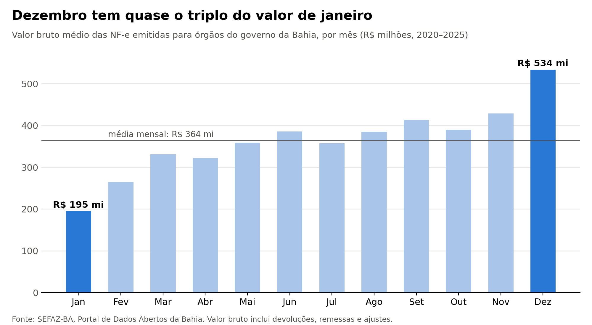
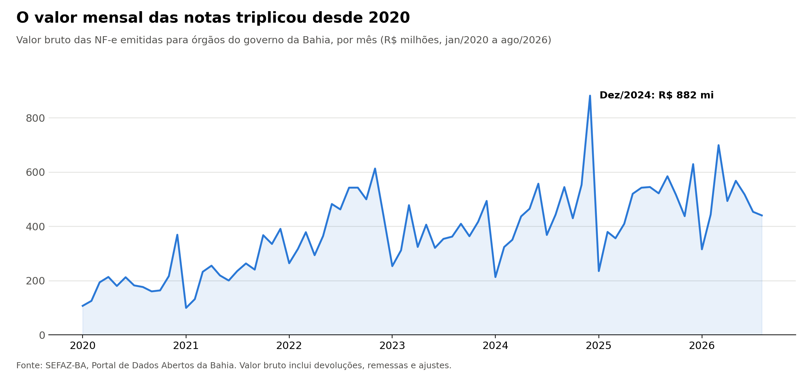

# Raio-X das notas fiscais de compras do Estado da Bahia

Análise exploratória de **1,4 milhão de notas fiscais eletrônicas** emitidas para órgãos
do governo da Bahia entre 2020 e 2026, feita durante a certificação em Ciência de Dados e IA
do Ibmec.

## Principais achados

- **A soma não é compra.** A base é publicada como "compras públicas", mas inclui devoluções,
  remessas, consertos, bonificações e notas de ajuste fiscal. Das 10 maiores notas, só 2 são
  vendas comuns. Os R$ 30,2 bilhões da coluna de valor são **valor bruto**, não o total comprado.
- **Nomes sem padrão dividem os totais.** O mesmo órgão aparece escrito de milhares de jeitos;
  metade do valor do Fundo Estadual de Saúde estava distribuída em outras grafias.
- **O orçamento anual aparece nos dados.** Janeiro tem cerca de metade do valor de um mês
  médio; dezembro, quase 50% a mais.

## Dados

"Notas Fiscais Eletrônicas (NFe) de Compras Públicas", produzido pela SEFAZ-BA e publicado no
[Portal de Dados Abertos do Estado da Bahia](https://dados.ba.gov.br/dataset/3c07c799-18c4-492d-85e4-8c8c998c8d9d).
Versão baixada em 09/09/2026. O arquivo não está neste repositório por causa do tamanho
(395 MB); para reproduzir, baixe-o na fonte e coloque na mesma pasta do notebook.

## Ferramentas

Python, pandas e Matplotlib, em Jupyter Notebook.

## Próximos passos

Construir uma base limpa: agrupar as naturezas da operação para separar compra de devolução,
remessa e ajuste, padronizar os nomes de órgãos e fornecedores e calcular quanto o Estado
comprou de fato.

---

**Karina Vivian** — analista fiscal em transição para dados.
